## 최신 디자인: B안 픽셀 다각도·의상 파츠

[전체 디자인과 파츠 도안](ink-hero-b/pixel-design/README.md) — 모션 적용 전 디자인 자료입니다. 아래 GIF는 이전 디자인의 모션 검토본입니다.

## 최신 확인: 일체형 의상 + 목도리

GitHub 폴더: **`assets/characters/ink-hero-c/integrated-outfit-motion/`**

[대기→달리기→정지 GIF](ink-hero-c/integrated-outfit-motion/movement-scarf.gif) · [다섯 모션 전체](ink-hero-c/integrated-outfit-motion/all-motions.gif) · [파일 안내](ink-hero-c/integrated-outfit-motion/README.md)

새 디자인은 몸·두건·상의·통 넓은 바지를 한 캐릭터 이미지로 만들고 목도리만 분리했습니다. 아래 다른 폴더는 이전 시안입니다.

## 최신 공통 의상 모션 — 생성 없이 바로 확인

[다섯 모션 GIF](ink-hero-c/shared-costume-motion-preview/all-motions.gif) · [개별 GIF와 설명](ink-hero-c/shared-costume-motion-preview/README.md)

`git pull` 후 `assets/characters/ink-hero-c/shared-costume-motion-preview/all-motions.gif`를 열면 됩니다.

## 최신: 선택한 짧은 로브 디자인 적용

[짧은 로브 v16](ink-hero-c/short-robe-v16/README.md) · [모션 GIF](ink-hero-c/short-robe-v16/preview-motion.gif)

구매 에셋 대기·달리기 위에 두건, 민소매 비대칭 로브, 목도리를 적용했습니다. 아래 긴 로브와 재디자인 시안은 이전 탐색 기록입니다.

> 최신 수정: 로브는 고정하고 목도리만 **처짐 → 점진적인 들림 → 정지 후 내려앉기**로 변경했습니다. 아래 v13 폴더의 GIF와 실행 파일을 갱신했습니다.

# 잉크 주인공 C — 캐릭터 작업 모음

현재 최신 방향은 **원본의 처진 두건·넓은 소매·긴 로브·목도리를 유지한 C 색감**입니다. 이전 비대칭 어깨천 디자인과 구분하여 보존합니다.

## 최신 작업: 3레이어 의상과 관성 모션 (v13)

[최신 시안 폴더와 실행 안내](ink-hero-c/three-layer-cloth-v13/README.md)

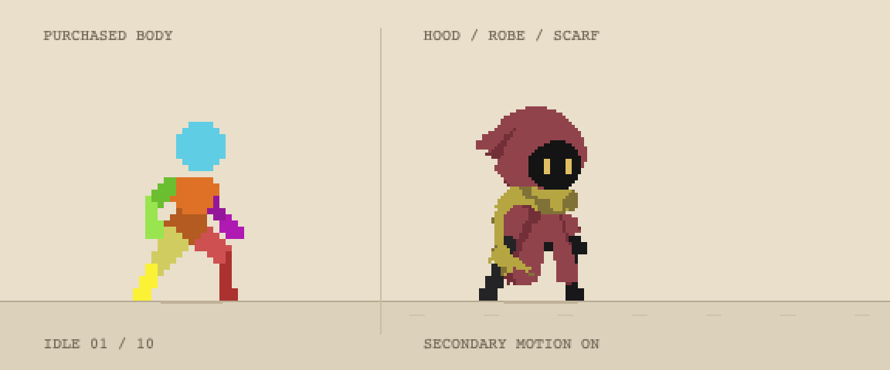

`work/asset-design` 브랜치에서 `git pull` 후 아래 파일을 브라우저로 열면 됩니다. 별도 설치나 서버는 필요 없습니다.

```text
assets/characters/ink-hero-c/three-layer-cloth-v13/index.html
```

- 방향키를 누르면 달리기, 놓으면 정지. 관성 유무와 몸체/로브/목도리를 개별 비교할 수 있습니다.
- 구매 Idle/Run 몸 동작에 원본 의상을 맞추고 옷 내부에 변형을 적용한 **브라우저 검증 시안**입니다. Unity 적용본은 아닙니다.
- 3레이어 Aseprite·투명 PNG·변형 코드·조사 자료를 함께 포함합니다.
- [원본 로브 디자인](ink-hero-c/concept-art/original-robe-wine-concept.png) / [스케치 맵에서 색 비교](ink-hero-c/concept-art/sketch-map-palette-comparison.png). 색 비교 이미지는 AI 시안으로 실제 게임 캡처가 아닙니다.

## 이전 C 어깨천 디자인과 작업 기록

## 먼저 보기

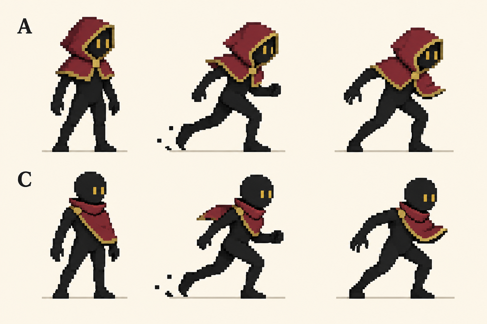

위 이미지는 디자인 방향 참고용 컨셉 아트이며 실제 게임 프레임이 아닙니다. 아래는 현재 C안의 실제 모션입니다.

| 대기 | 걷기 | 달리기 |
|---|---|---|
| 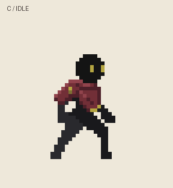 | 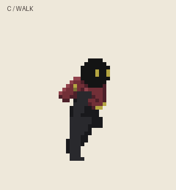 | 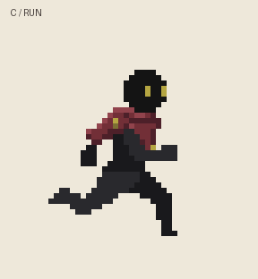 |

## 최신 검 전투 시안

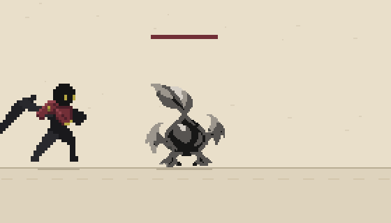

**GIF는 무음입니다.** [전투 시안 폴더](ink-hero-c/sword-combat)의 `index.html`을 다운로드한 폴더에서 브라우저로 열면 직접 조작하고 소리를 들을 수 있습니다. GitHub의 HTML 파일 화면은 게임을 실행하지 않습니다. 별도 설치·서버는 필요 없으며, 관련 파일을 함께 받아야 합니다.

- ← → 이동 / S 평타 / D 강베기 / R 초기화 / '소리 켜고 시작'.
- 평타: 피해 10, 0.20초 적중, 전체 0.40초.
- 강베기: 피해 35, 0.30초 적중, 전체 0.70초, 쿨타임 5초.
- 가시뿌리의 승인된 대기·피격·사망, 실제 명중 판정, 신규 잉크 VFX, 기존 승인 SFX 연결.
- VFX·SFX·순간 정지·흔들림을 각각 끄거나, 헛치기·벽 차단을 비교할 수 있습니다.
- **독립 브라우저 시안입니다. Unity 적용, 적의 반격 AI, 전체 콤보가 완료됐다는 뜻은 아닙니다.**

## 폴더 안내

| 경로 | 내용 / 상태 |
|---|---|
| [concept-art](ink-hero-c/concept-art) | A/C 디자인, 색 조합, 이전 컨셉 탐색 이미지. 탐색안은 채택안과 구분 |
| [design](ink-hero-c/design) | C 의상 디테일 v5: PNG·편집용 Aseprite·작업 메모 |
| [basic-motions](ink-hero-c/basic-motions) | 대기·걷기·달리기 v6: PNG 프레임·GIF·Aseprite·검증 기록 |
| [weapon-studies](ink-hero-c/weapon-studies) | 검·레이피어 및 추가 6종 무기 적용 가능성 시안. 최종 모션 아님 |
| [sword-combat](ink-hero-c/sword-combat) | 최신 검 평타·강베기 피격/VFX/SFX 시안, 투명 VFX 프레임, 타이밍 |
| [asset-manifest.json](asset-manifest.json) | 선별 파일의 원본 작업 경로와 SHA-256 |

## 무기 미리보기

| 기본검 연타 연구 | 레이피어 |
|---|---|
| 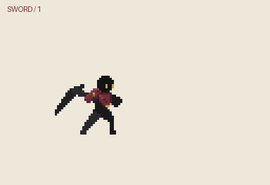 | 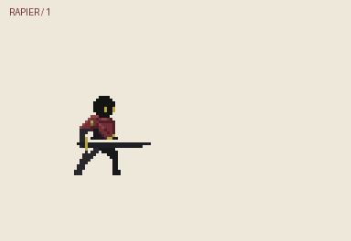 |

| 망치 | 방패 | 대검 |
|---|---|---|
| 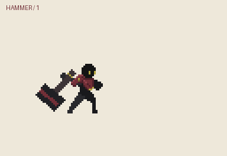 | 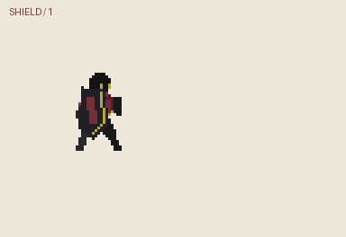 | 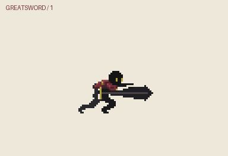 |

| 발사기 | 수리검 | 폭탄 |
|---|---|---|
| 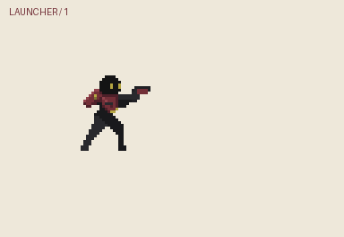 | 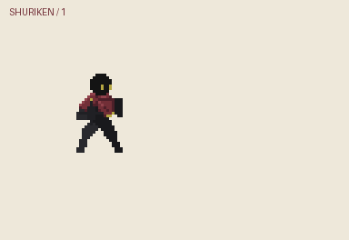 | 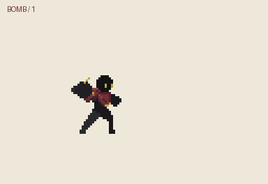 |

무기 그림·잡는 손·양손 지지·투척 릴리스에는 추가 보정이 필요합니다. 위 GIF의 궤적은 게임 판정이나 최종 VFX가 아닙니다. 검의 실제 적중/소리 검토는 최신 `sword-combat`를 기준으로 합니다. 상세 한계는 [무기 작업 안내](ink-hero-c/weapon-studies/README.md)를 참고하세요.

## 선별 기준

C 의상 수정 전 초기 실패 모션, 부자연스러운 채찍·단검 모션, 중복 비교 화면, 임시 캡처, 구매 원본 ZIP은 제외했습니다. 컨셉 아트는 요청에 따라 별도로 남겼으며, 탐색 이미지가 현재 채택안이라는 의미는 아닙니다. 원본 작업 폴더는 이 업로드로 삭제하지 않았습니다.

## 출처 및 사용

- 몸 모션: 사용자가 구매한 **2D Pixel Art Character Template**에서 파생. 전체 구매 원본은 포함하지 않습니다. 사용·공유 범위는 원본 라이선스를 따릅니다.
- 의상·무기 적용: 이 대화에서 제작한 C 디자인 및 파생 작업. Aseprite 편집 파일과 합성 PNG 포함.
- 가시뿌리·소리: 본 게임 레포 `ae398c6516d59bd0b0e95dbb00714e3ad49ea2d6`의 승인 에셋. 검 기본음은 해당 레포에서 선택한 Minifantasy Dungeon SFX 파생본입니다.
- 신규 잉크 VFX: `sword-combat/fx.js`, 투명 프레임은 `sword-combat/assets/fx-export/`.
- 팔레트 참고: 사용자가 제공한 OLD KIDS STUDIO 색 조합 이미지. 주색 `#141414`, 보조 `#722F37`, 포인트 `#B5A642`.

PNG는 정수 배율·Point/Nearest 필터로 확인하세요. 캐릭터와 몬스터의 캔버스/피벗/배율이 다르므로 최신 전투 시안의 `content.json`과 `README.txt`를 따라 이식해야 합니다.
