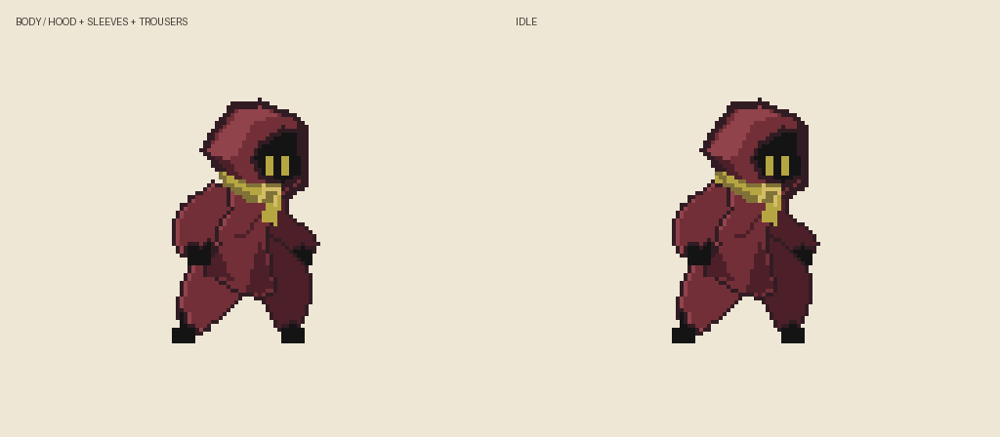

# B안 · 기존 에셋 대기/달리기 적용

별도 실행 없이 GIF를 열면 됩니다. `work/asset-design` 브랜치에서 `git pull` 후 이 폴더를 확인하세요.

## 두건·목도리 수정

[대기 전후](hood-scarf-idle-comparison.gif) · [달리기 전후](hood-scarf-run-comparison.gif). 목도리 감김·장식·꼬리 시작점을 몸통 방향으로 작업 해상도 3픽셀 내렸습니다. 두건은 높은 각진 꼭대기를 낮추고 뒤쪽이 한 번 접히는 둥근 형태로 수정했습니다. 아래 상의 전후 비교는 직전 수정 기록입니다.

## 상의 수정

[수정 전후 달리기 비교](shirt-before-after.gif): 고정된 긴 세로 명암과 사다리꼴 상의 대신 몸통 단면을 따른 가슴/허리 폭을 사용합니다. 앞팔 방향에 따라 짧은 가슴 주름이 달라지고, 앞다리 방향에 따라 밑단이 접힙니다. 별도 천 물리로 상의를 흔드는 방식은 아닙니다.

## 먼저 볼 파일

**movement-comparison.gif**: 왼쪽은 목도리 꼬리를 뺀 몸체, 오른쪽은 목도리를 합친 모습입니다. 대기 → 달리기 → 대기로 전환하는 6초 비교입니다. 별도 급정지 동작은 아직 없으며 정지 구간은 대기 자세로 돌아가 목도리가 가라앉습니다.

- [run-body-only.gif](run-body-only.gif): 옷과 몸의 결합을 확인할 달리기
- [run.gif](run.gif): 목도리가 있는 달리기
- [idle-body-only.gif](idle-body-only.gif): 목도리 꼬리 없는 대기
- [idle.gif](idle.gif): 목도리가 있는 대기
- [대기 디자인](idle-design.png)
- [18개 자세를 펼쳐 본 이미지](body-frame-review.png)

## 이번에 바뀐 구조

구매 에셋의 대기 10프레임과 달리기 8프레임에서 자세와 타이밍을 가져왔습니다. 원본 실루엣을 2배 해상도로 작업하여 옷의 폭을 보정했습니다. 기존 캐릭터 위에 고정된 의상 그림을 덮는 방식이 아닙니다.

- 소매는 각 프레임의 실제 팔 실루엣을 따라 넓어집니다. 손끝은 검은 잉크로 남깁니다.
- 바지는 각 다리의 굽은 실루엣을 따라 폭을 늘리고 발목에서 좁아집니다. 두 다리를 잇는 로브 꼬리는 없습니다.
- 몸·후드·소매·상의·바지·목도리의 목 감김/앞 장식은 한 몸체 프레임에 합칩니다.
- 목도리 뒷자락만 별도 움직이며, 몸 뒤에 가려집니다. 뒷자락의 움직임은 몸체 픽셀을 바꾸지 않습니다.

## 확인 결과와 범위

모든 18개 자세를 펼쳐 소매/바지 실루엣과 가림 순서를 검토했습니다. 모든 팔·다리 원본 픽셀이 새 의상 또는 손발로 덮이는지, 목도리 움직임과 무관하게 같은 자세의 몸체가 동일한지, 몸체와 꼬리 합성이 최종 이미지와 같은지 검사했습니다. GIF 재생 시간은 대기 950ms, 달리기 640ms, 비교 6000ms입니다. GIF 저장 중 동일한 대기 프레임이 합쳐져 파일 내부 프레임 수는 7개지만 시간은 유지됩니다. 기존 파이프라인 테스트 10개도 통과했습니다.

이 결과는 **B안의 첫 모션 적용 시안**입니다. 컨셉 이미지의 주름과 비율을 그대로 옮긴 완성 작화는 아니며 낮은 해상도에 맞춰 단순화했습니다. 실제 게임/Unity에 적용하거나 점프·공격·구르기를 보정한 결과는 아닙니다. 팔·다리 실루엣 기반 생성은 관절이 있는 3D 리깅과 다르므로 다른 동작의 가림과 손발 구분은 추가 검토가 필요합니다.

제작 코드: `tools/character-costume/b_outfit.py`. 구매 원본 ZIP과 원본 레이어는 이번 폴더에 포함하지 않았습니다.
