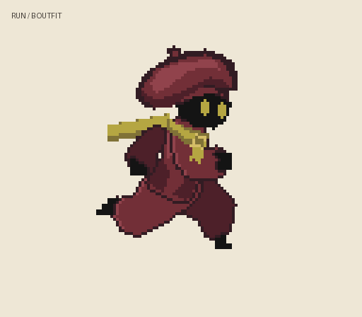

# A 베레모 적용 · B 의상 대기/달리기

## 최신: 목도리 위치·의상 통 보정

[대기 전후](idle-fit-comparison.gif) · [달리기 전후](run-fit-comparison.gif)

목도리는 원본 몸통 상단 대신 보이는 머리 하단을 기준으로 위치를 잡습니다. 감김 부분·앞 장식·뒷자락 시작점이 같은 기준을 사용합니다. 상의 옆 폭은 15% 줄이고, 바지는 원본 다리 주변에 더하던 최대 여유 폭을 약 4픽셀에서 3픽셀로 줄였습니다. 소매도 약간 좁혔습니다. 모자·눈 디자인은 유지했습니다. 전체 18개 자세와 합성 검사를 확인했으며 아래 비교 자료들은 이전 단계 기록입니다.

## 최신: 과도한 모자 크기 보정

[다각도 기준과 확대 비교](hat-reference-crosscheck.png) · [대기 크기 전후](idle-size-comparison.gif) · [달리기 크기 전후](run-size-comparison.gif)

밴드의 머리 접점을 유지하고 모자 크라운을 가로·세로 20% 줄였습니다. 눈과 몸체 비율은 유지했습니다. 비교 이미지는 눈 높이를 비슷하게 맞춘 시각 검토용이며 다각도 도안은 정확한 정투영 설계도가 아닙니다. 아래 약 1.7배 폭 설명과 이전 비교는 과대했던 수정 기록입니다.

## 이전: 모자 볼륨과 눈 모서리 수정

[다섯 방향 디자인 기준](../hat-design/A-beret-refined-turnaround.png) · [대기 수정 전후](idle-refinement-comparison.gif) · [달리기 수정 전후](run-refinement-comparison.gif)

눈은 작업 해상도 3×6픽셀 세로 형태에서 네 모서리만 제거했습니다. 기울이거나 중간을 부풀리지 않습니다. 모자는 머리 폭 대비 약 1.7배로 넓히고 한쪽 끝을 낮춰 원안의 풍성한 볼륨을 반영했습니다. 컨셉 이미지와 미세한 주름까지 동일한 완성 작화는 아닙니다. 다각도 이미지는 내장 image_gen으로 생성한 디자인 참고이며, 후면 게임 모션을 구현한 것은 아닙니다. 아래 기존 후드 전후 비교 GIF는 이전 버전 기록입니다.

선택한 A 베레모를 기존 구매 에셋의 대기 10프레임·달리기 8프레임에 적용했습니다. 새로 다듬었던 상의, 넓은 소매와 바지, 낮춘 목도리 위치를 유지했습니다.

## 바로 확인

- [후드 → 베레모 달리기 비교](run-before-after.gif)
- [후드 → 베레모 대기 비교](idle-before-after.gif)
- [대기](idle.gif)
- [목도리 전후 · 대기→달리기→대기](movement-comparison.gif)
- [대기 한 장](idle-design.png)
- [전체 18개 자세](body-frame-review.png)

비교 GIF 왼쪽은 직전 후드 버전, 오른쪽은 베레모 버전입니다. 별도 실행이 필요 없습니다.

## 변경

- 얼굴을 감싸는 후드를 없애고 검은 잉크 머리를 드러냈습니다.
- 한쪽으로 처진 낮은 와인색 베레모와 좁은 모자 밴드를 머리에 함께 그렸습니다.
- 눈은 세로 형태를 유지하면서 네 모서리만 깎았습니다.
- 모자·얼굴·의상은 몸체 프레임으로 통합하고 목도리 뒷자락만 따로 움직입니다.

디자인을 작은 해상도로 단순화한 첫 적용 시안입니다. 컨셉 보드와 동일한 정밀 작화는 아닙니다. 실제 게임 적용이나 다른 동작 제작은 아직 하지 않았습니다. 전환 GIF의 정지 구간은 별도 제동 동작 없이 대기로 돌아갑니다.

## 확인

18개 자세의 전체 프레임 이미지를 검토했습니다. 원본 팔·다리 픽셀의 누락 없음, 목도리 상태와 무관한 몸체 동일성, 몸체+목도리 합성 일치 검사를 통과했습니다. 모든 GIF가 정상 해독되며 대기 950ms·달리기 640ms·전환 6000ms 재생 시간을 유지합니다. 동일 프레임은 GIF 저장 시 합쳐질 수 있습니다.

제작 코드: `tools/character-costume/b_outfit.py`. 구매 원본 ZIP과 원본 레이어는 포함하지 않았습니다. 이전 후드 결과는 `../basic-motion/`에 보존했습니다.
