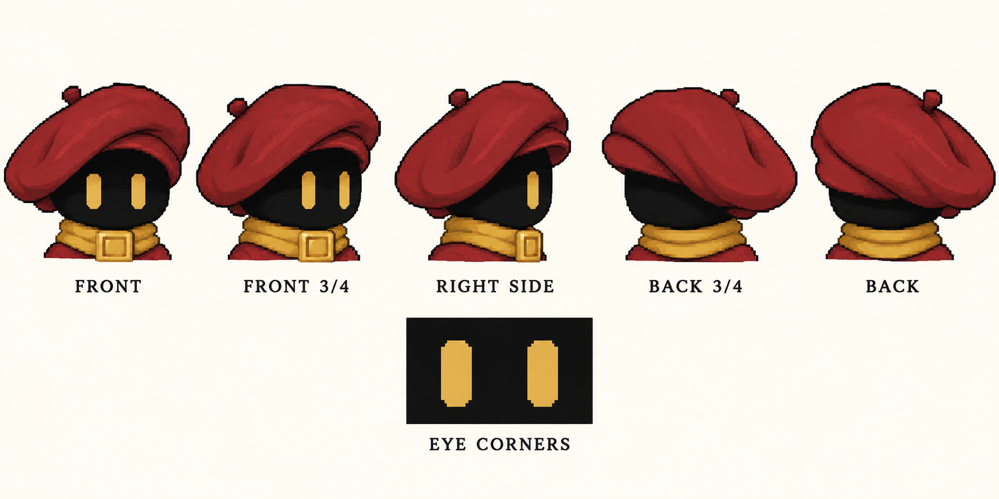
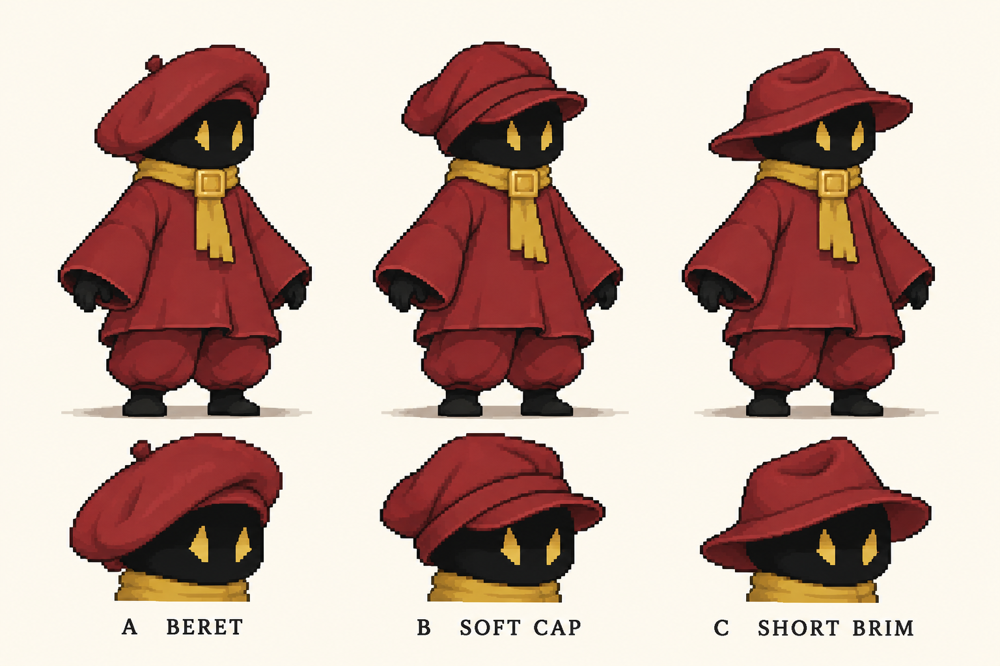

# 모자와 눈 재디자인

## 선택한 A안 최신 기준

A안의 넓은 볼륨과 한쪽 처짐을 유지하고 눈은 세로 형태의 네 모서리만 깎습니다. 아래 최초 시안의 뾰족한 눈은 사용하지 않습니다. 내장 image_gen으로 생성했으며 프롬프트는 refined-turnaround-prompt.txt에 있습니다.

기존 B안 의상은 유지하고 후드 대신 머리 위에 별도로 쓰는 모자를 비교했습니다. 여기의 A/B/C는 모자 선택지이며 기존 의상 B안과 별개의 표기입니다.

- A: 비대칭 베레모. 그림/잉크 세계관을 연상시키며 둥근 실루엣을 유지합니다.
- B: 짧은 챙과 뒤로 처진 천 모자. 진행 방향을 읽기 쉽습니다.
- C: 둘레에 챙이 있는 낮은 모자. 방랑자 느낌이 강하고 가로 실루엣이 넓습니다.

눈은 직사각형 막대 대신 끝이 좁아지는 황동색 획 형태로 변경했습니다. 실제 작은 스프라이트에서는 크기와 기울기를 다시 정리해야 합니다.

내장 image_gen으로 만든 픽셀 스타일 컨셉 비교입니다. 아직 구매 에셋 모션에 적용하지 않았습니다. 사용한 프롬프트는 generation-prompt.txt에 있습니다.
