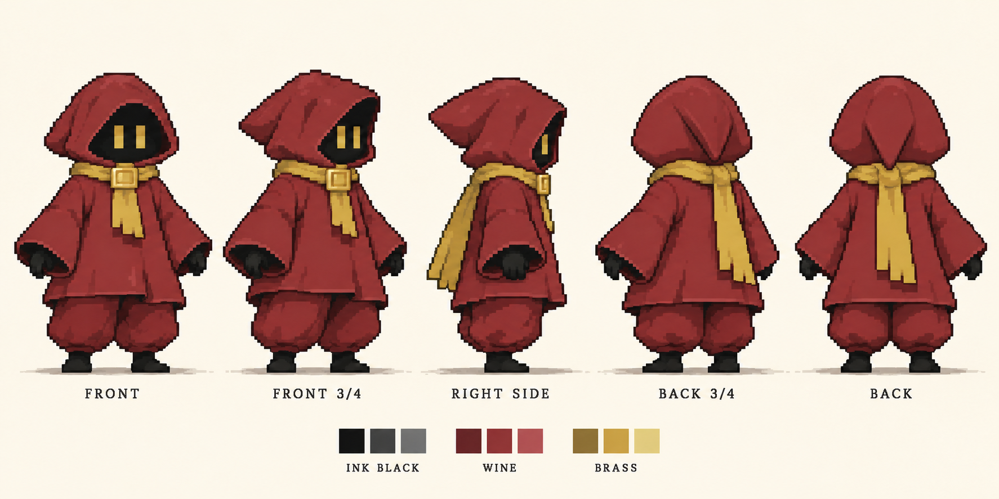
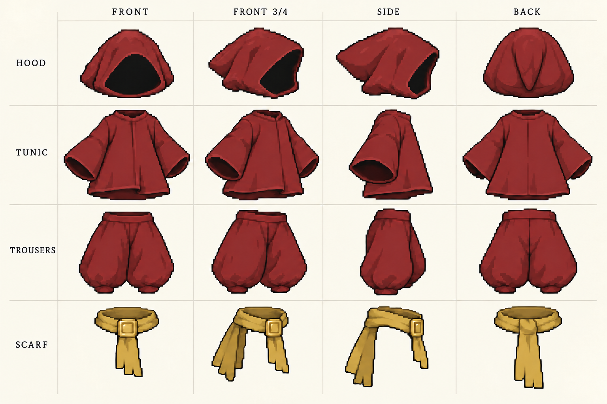

# B안 픽셀 디자인 · 다각도와 의상 파츠

선택한 B안의 둥근 두건, 넓은 소매, 짧고 여유 있는 상의와 통 넓은 바지를 유지했습니다. 검은 어깨 장식은 없습니다. 후드 끝은 뒤통수 중앙에 하나만 내려오는 구조이며, 후면과 뒤 사선의 귀처럼 갈라졌던 형태를 수정했습니다.

## 전체 캐릭터

정면 · 앞 사선 · 오른쪽 측면 · 뒤 사선 · 후면. 검은 잉크 얼굴/손발과 와인색 의상, 황동색 눈/목도리를 기준으로 합니다. 측면은 눈 하나, 후면은 눈이 보이지 않습니다.

## 의상 구조

두건 / 상의와 넓은 소매 / 통 넓은 바지 / 목도리를 정면·앞 사선·측면·후면으로 정리한 제작 참고 도안입니다.

## 에셋 적용 기준

- 두건은 머리 회전과 함께 움직이며 눈은 얼굴 방향에 맞춰 배치합니다.
- 소매는 팔 자세에 맞춰 함께 그립니다. 정지된 상의를 움직이는 팔 위에 덮는 방식으로 사용하지 않습니다.
- 바지는 두 다리의 실루엣에 맞춰 각각 그리며, 넓은 통과 좁은 발목의 대비를 유지합니다. 치마나 로브 밑단처럼 다리 사이를 잇지 않습니다.
- 제작 중 의상 파츠는 수정 편의를 위해 분리할 수 있지만, 최종 모션 프레임에서는 몸·두건·상의·바지를 통합합니다. 목도리 꼬리만 별도 움직임 대상으로 둡니다.
- 목도리의 목 감김·앞 장식은 몸에 고정합니다. 뒷자락은 대기 시 아래로 처지고 이동 속도에 따라 점차 들리게 합니다.

## 현재 결과의 범위

이번 PNG는 AI로 만든 **픽셀 스타일 디자인 도안**입니다. 실제 원본 해상도의 정렬된 스프라이트 시트나 투명 레이어 파일, Aseprite 원본이 아닙니다. 구매 에셋 모션에 아직 적용하지 않았습니다. 각도별 주름과 목도리 연결부는 실제 프레임 제작 시 동일 구조로 맞춰야 합니다.

다음 제작 기준은 앞 사선과 측면입니다. 구매 에셋의 실제 프레임 크기와 관절 위치에 맞춰 대기 한 프레임을 먼저 정리하고, 달리기에서 소매·바지 가림 순서를 검증한 뒤 다른 모션으로 확장합니다.

내장 image_gen으로 생성했습니다. 사용한 프롬프트는 [generation-prompts.json](generation-prompts.json)에 보관했습니다.
