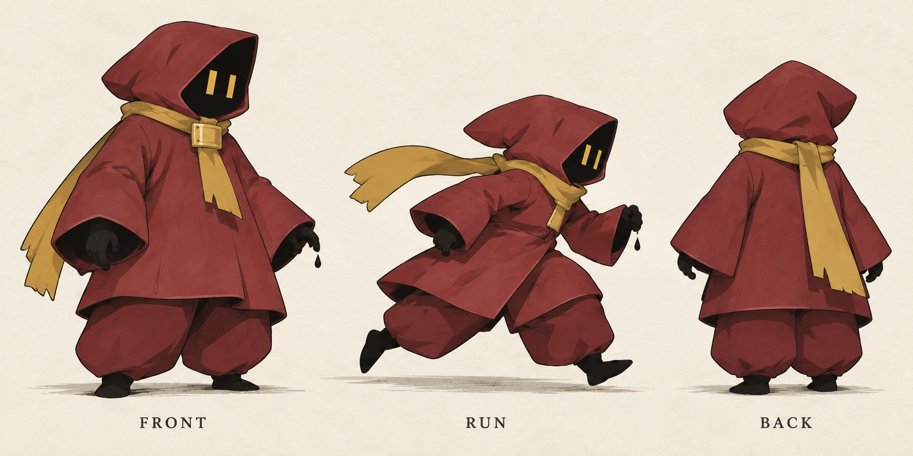
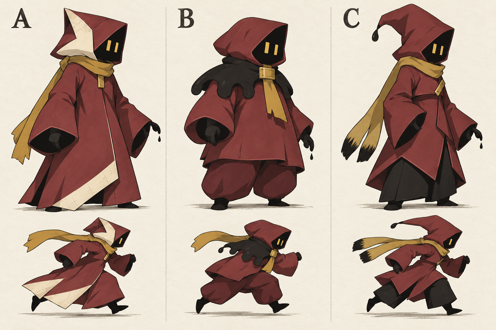
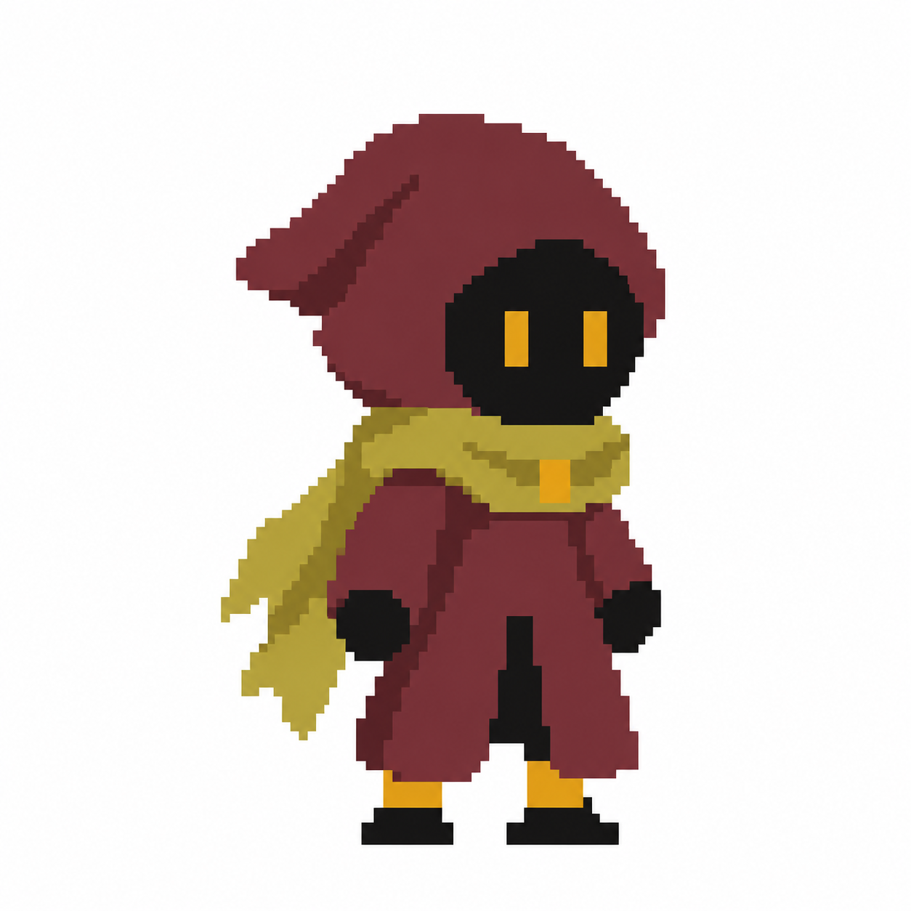
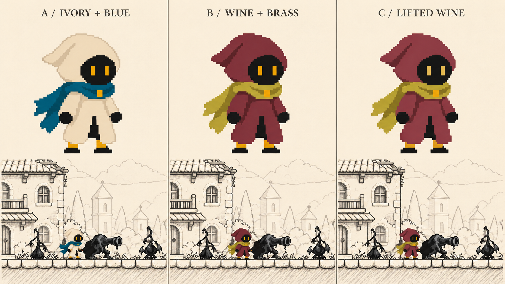
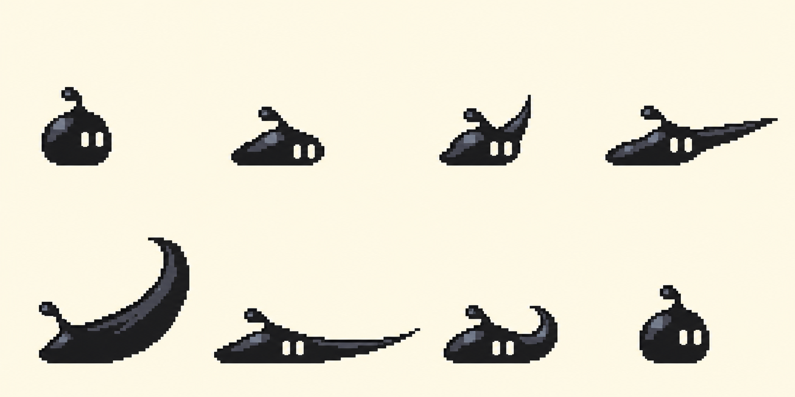
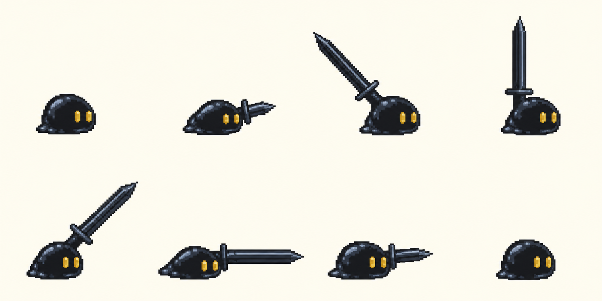
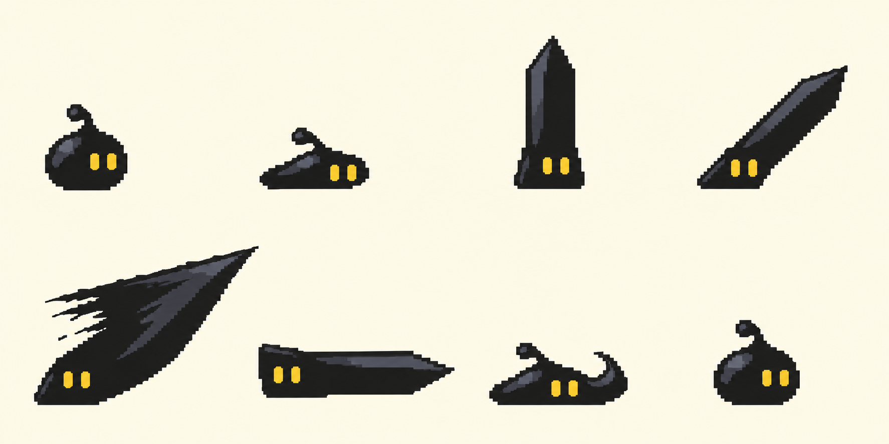
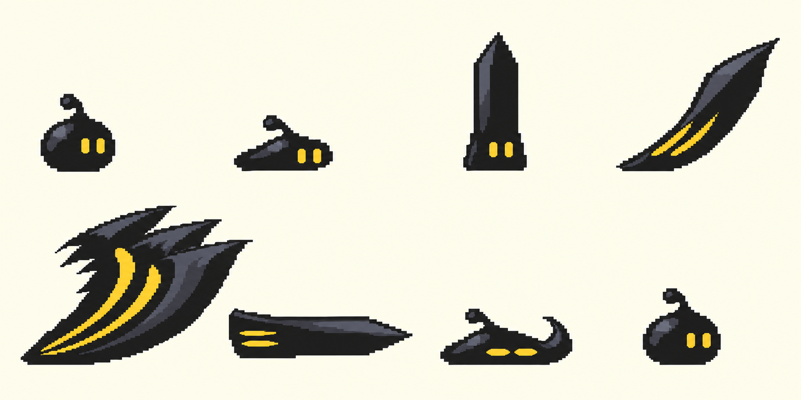
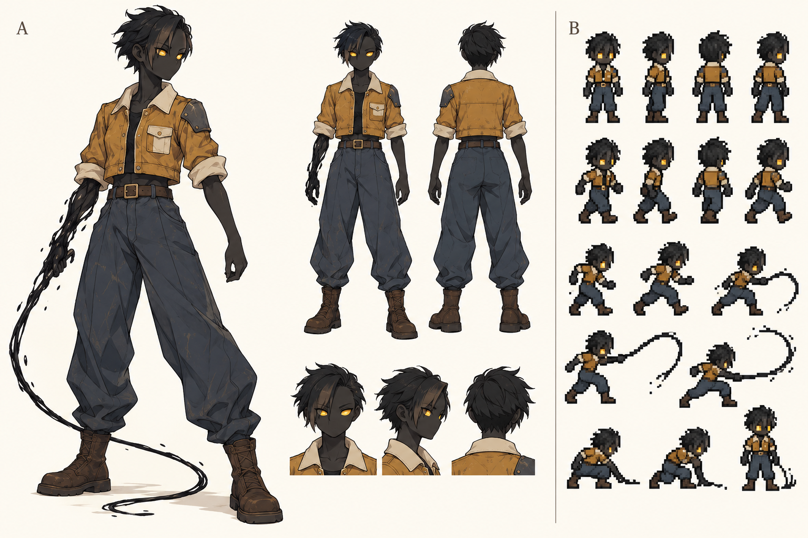

# B안 정리 — 어깨 장식 제거

둥근 와인색 후드, 넓은 소매, 여유 있는 짧은 상의와 발목으로 모이는 통 넓은 바지를 유지했습니다. 어깨의 검은 잉크 망토는 제거하고 와인색 옷으로 연결했습니다. 검은 얼굴과 손발, 황동색 눈과 목도리를 사용합니다.

앞·달리기·뒤 모습을 담은 **컨셉 이미지**입니다. 기존 에셋에 적용한 애니메이션은 아닙니다. 실제 적용 시 몸체·후드·상의·바지는 한 프레임에 통합하고 목도리만 분리하는 방향입니다. 목도리 연결과 옷 주름은 픽셀 제작 단계에서 일관되게 정리해야 합니다.

---

# 캐릭터 재디자인 탐색 v15

구매 에셋은 동작 기준으로 사용하고, 노출된 기본 몸체가 보이지 않도록 의상의 큰 실루엣을 새로 설계하는 탐색입니다. 아직 선택하거나 에셋에 이식한 결과가 아닙니다. 아래 달리기 자세도 AI 컨셉 이미지이며 실제 모션 검증이 아닙니다.

- A: 접힌 페이지 같은 두건과 겹친 긴 로브. 종이·잉크 세계의 시각적 연결이 강하지만 긴 밑단의 자세별 보정이 필요합니다.
- B: 넓은 소매와 여유 있는 하의로 팔다리를 덮는 구조. 에셋의 관절 위치를 유지하며 옷을 붙이기 가장 유리한 후보입니다.
- C: 붓끝 같은 두건과 먹물이 묻은 목도리. 특징은 선명하지만 긴 외투와 하의의 겹침 보정이 필요합니다.

추천 검토 방향은 A의 접힌 종이 모티프에 B의 팔다리 의상 연결 구조를 결합하는 것입니다. 디자인만 바꿔도 기존 부착 오류가 해결되는 것은 아니며, 소매와 하의는 실제 자세에 맞춰 부착·겹침을 검증해야 합니다.

---

# 최신 원본 로브 방향

큰 두건·넓은 소매·긴 로브·목도리의 원본 실루엣을 유지하는 방향으로 변경했습니다. 아래는 컨셉 이미지이며 실행용 픽셀 자산은 `../three-layer-cloth-v13/assets/`에 있습니다.

색 비교는 AI로 만든 배치 시안이며 실제 게임 화면의 정량 검증 결과가 아닙니다. C의 밝힌 와인색을 선택했습니다.

---

# 컨셉 아트

이전 어깨천 방향은 `A-C-pixel-concept.png`의 **C**를 출발점으로 한 검은 잉크 인간형 + 와인색 어깨천 + 황동색 눈입니다. 실제 픽셀 모션은 상위 `basic-motions/`에 있습니다.

`exploration-*.png`는 이전 슬라임·전신 무기 변형·인간형 탐색 기록입니다. 컨셉 이미지 보존용이며 채택안이나 구현 가능한 프레임 시트로 취급하지 않습니다. 해당 시기의 실패 모션은 포함하지 않았습니다.

색 조합 참고: [사용자 제공 팔레트](palette-reference.png).
