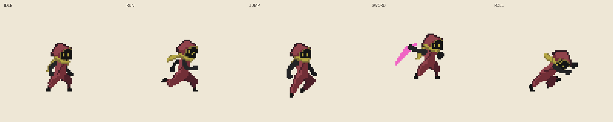

# 일체형 의상 + 목도리

**이 폴더가 최신 확인 위치입니다.** 생성 도구 실행 없이 GIF를 바로 열면 됩니다.

GitHub 폴더: `assets/characters/ink-hero-c/integrated-outfit-motion/`

| 확인할 내용 | 파일 |
|---|---|
| 먼저 볼 것: 대기 → 달리기 → 정지, 목도리 관성 | [movement-scarf.gif](movement-scarf.gif) |
| 대기·달리기·점프·검 공격·구르기 한 번에 비교 | [all-motions.gif](all-motions.gif) |
| 달리기 기존 로브/바지와 새 일체형 비교 | [run-before-after.gif](run-before-after.gif) |
| 구르기 기존/새 형태 비교 | [roll-before-after.gif](roll-before-after.gif) |
| 개별 모션 | [idle.gif](idle.gif) · [run.gif](run.gif) · [jump.gif](jump.gif) · [sword.gif](sword.gif) · [roll.gif](roll.gif) |

## 디자인과 레이어

갈라진 로브 밑단을 없애고 와인색 상의에서 통 넓은 바지로 이어지는 옷으로 바꿨습니다. 검은 손·발과 황동색 눈, 작은 후드를 유지합니다.

- **body:** 몸·두건·상의·바지를 한 프레임에 합성해 확정한 캐릭터 이미지. 재생 시 별도 바지나 후드를 부착하거나 움직이지 않습니다.
- **scarf:** 목도리만 별도 이미지. 꼬리는 몸 뒤에서 움직이고 목둘레는 몸에 고정됩니다. 앞팔과 겹칠 때의 가림도 반영합니다.

제작 과정에서는 구매 에셋의 부위와 자세를 참조하지만, 최종 로컬 출력은 이 두 레이어뿐입니다. 두 레이어를 합친 결과와 GIF의 캐릭터가 같은지 37프레임에서 확인했습니다. 공개 폴더에는 투명 원본 프레임이 아닌 미리보기만 포함합니다.

## 보정과 확인

- 바지 폭과 주름은 다리의 실루엣을 기준으로 만들고, 기존 로브 조각은 사용하지 않습니다.
- 점프 등에서 원본 색이 부위가 아닌 음영으로 사용되는 것을 확인하여 색으로 종아리를 추정하던 방식을 새 일체형에서 제거했습니다.
- 구르기의 머리 숙임과 접힌 무릎 가림 순서를 유지했습니다.
- 대기 중 눈의 모양이 바뀌는 반올림 문제를 방지합니다.
- 목도리는 대기에 처지고 달리면 서서히 들리며 정지하면 내려옵니다. 이때 같은 자세의 몸 이미지가 목도리 상태와 무관하게 동일한지 검증했습니다.

구매 원본의 5개 모션, 총 37개 자세와 타이밍을 사용했습니다. 급정지 전용 자세는 원본에 없어 Idle로 전환합니다. 게임 엔진에 통합된 결과는 아니며, 검 공격의 무기 색·형태는 아직 원본 테스트 그래픽입니다.
