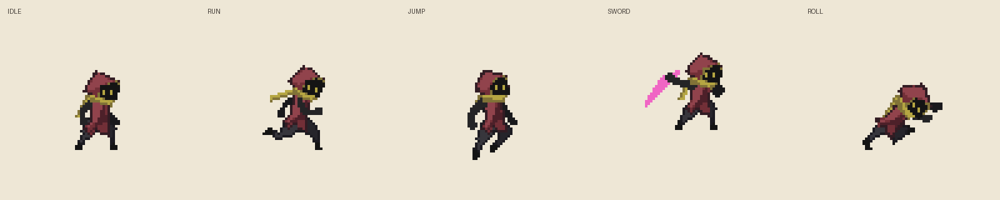

# 공통 의상 모션 — 바로 보는 미리보기

`git pull` 후 이 폴더의 **all-motions.gif**를 열면 됩니다. Python, 구매 ZIP, 생성 과정, 웹 서버가 필요 없습니다.

- [대기](idle.gif)
- [달리기](run.gif)
- [점프](jump.gif)
- [검 공격](sword.gif)
- [구르기](roll.gif)

공통 의상 도구에서 실제로 생성한 결과를 배경 위에 확대해 내보냈습니다. 원본 비교 화면, 개별 스프라이트 및 투명 시트는 이 폴더에 포함하지 않았습니다.

이 결과는 동일한 의상 규칙을 37프레임에 적용한 검증 시안입니다. 구르기의 얼굴 방향·앞무릎·앞팔의 겹침과 접힌 밑단을 보정했습니다. 바지는 원본 종아리 영역에서 신발 경계를 잡으며, 과한 바지 외곽 확장을 제거했습니다. 대기의 눈 크기 반올림 오류도 수정했습니다. 목도리는 동작별 정착 각도이며 출발·정지 관성 시연은 아닙니다. 검 공격의 무기 색과 형태는 원본 상태입니다. 점프·공격·구르기 GIF는 비교를 위해 반복 재생합니다.

## 이번 수정 비교

[달리기 수정 전후](run-before-after.gif) · [구르기 수정 전후](roll-before-after.gif)

각 GIF의 왼쪽은 이전 버전, 오른쪽은 보정 후입니다. 원본 에셋의 자세·프레임 수·타이밍을 유지했습니다. 게임 내 적용은 별도 검증이 필요합니다.
