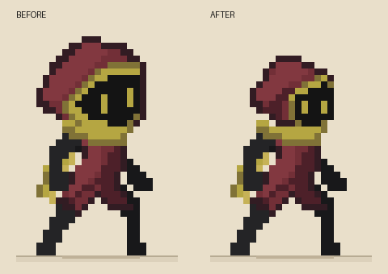
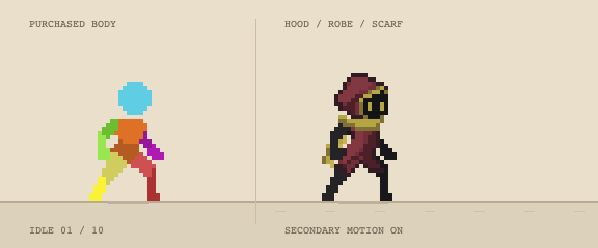

## 머리 보정

후드 외곽 범위를 17×16에서 13×12 픽셀로 줄이고 위로 솟은 형태를 낮췄습니다. 눈은 같은 높이의 1×2 픽셀 두 개로 맞추고, 넓은 황동색 얼굴 테두리를 얇은 사선으로 정리했습니다. 대기·달리기 미리보기와 GIF를 갱신했습니다. 저해상도 단순화 시안이므로 원본 컨셉의 세부 작화와는 차이가 있습니다.

# 짧은 로브 적용 시안 v16

사용자가 선택한 두건 / 민소매 짧은 로브 / 황동색 목도리를 구매 에셋의 48×48 픽셀 기준에 맞춰 단순화한 적용 시안입니다. 첨부 컨셉 이미지와 같은 해상도·디테일의 완성 작화는 아닙니다.

- `preview-motion.gif`: 구매 원본과 의상 적용 결과의 6초 비교. 대기 → 달리기 → 정지.
- `index.html`: 직접 조작. 방향키로 달리고 놓으면 정지. 별도 설치·서버 없이 실행.
- `design-reference.png`: 사용자가 선택한 디자인.
- `assets/`, `content.json`: 구매 Idle 10 / Run 8 프레임의 원래 팔다리 위치와 정확한 프레임 시간.
- `cloth.js`: 머리에 부착되는 두건, 어깨·골반에 맞춘 하나의 짧은 로브, 목에 고정된 목도리.
- `app.js`: 동작 전환 및 목도리 관성. 목도리는 처진 상태에서 서서히 들리고 정지 후 내려옵니다.

팔은 민소매 밖으로 드러나며 앞팔은 로브 앞에, 뒷팔은 뒤에 그립니다. 밑단은 무릎이나 각 다리에 붙이지 않습니다. 로브와 두건에는 별도 관성을 넣지 않았습니다.

브라우저에서 Idle/Run/Idle 전환, 좌우 조작, 로브 관성 없음, 목도리 정착 및 오류 없이 실행됨을 검증했습니다. Unity 게임에 통합한 상태는 아니며, 별도 급정지 원본이 없어 Idle로 전환합니다. GIF는 20fps 미리보기이고 실행 파일은 원본 동작 시간을 사용합니다.
