# 배경·맵 시각 시안

## 비공개 잉크 연구동 전경 v7 · 스팀펑크

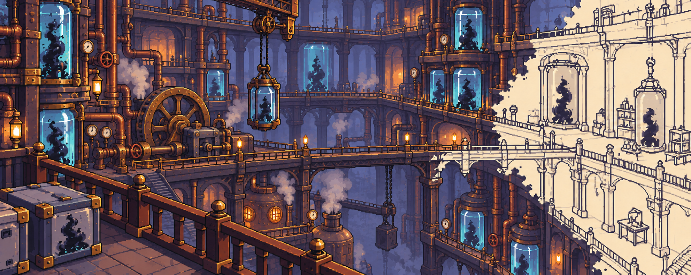

2026-10-22 검토용 이미지. v6의 굵은 도트 구도와 오른쪽 스케치화 구역을 유지하면서, 왼쪽과 중앙의 잉크 처리 장치에 커다란 기어·증기관·압력계·보일러·현수식 운반기를 더했습니다. 황동은 낡고 무광으로 표현해 작은 금속 장식과 번쩍이는 반사가 화면을 지배하지 않게 했습니다. 시설 장비의 작동 방식과 배치는 확정 설정이 아니며 실제 게임 맵에는 반영하지 않았습니다.

## 비공개 잉크 연구동 전경 v6 · 도트 형태 재구성

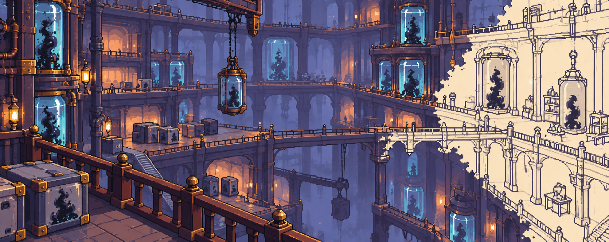

2026-10-22 검토용 이미지. v5는 기존 구성의 색과 재질만 바뀌고 가는 선·미세 장식이 남아 있어 실제 게임의 도트 밀도와 달랐습니다. v6은 같은 전체 조망 구도를 유지하면서 난간·아치·용기와 오른쪽 스케치화 구역의 윤곽선을 더 큰 계단형 픽셀 덩어리로 다시 구성했습니다. 여전히 최종 타일셋이나 실제 게임 해상도 검증본은 아니며 Unity 씬은 변경하지 않았습니다.

## 비공개 잉크 연구동 전경 v5 · 기존 게임 화풍 참고

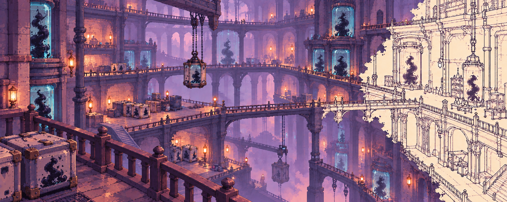

2026-10-22 검토용 이미지. v4의 전체 조망 구도와 오른쪽 흰 스케치화 벽·통로를 유지하고, 사용자가 제공한 기존 게임 화면의 부드러운 보랏빛 도트 명암과 층별 깊이감을 화풍 참고로 삼았습니다. 광택 금속·촘촘한 배관·금색 반사광을 줄이고 무광 석재와 단순한 큰 면으로 정리했습니다. 숲의 식물이나 UI는 가져오지 않았습니다. 실제 픽셀 밀도와 타일 규격을 맞춘 게임 에셋은 아니며 Unity 씬은 변경하지 않았습니다.

## 비공개 잉크 연구동 전경 v4 · 전체 공간 조망

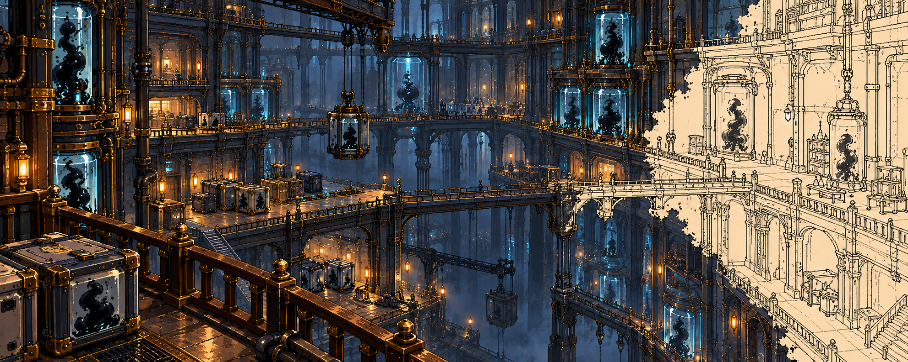

2026-10-22 검토용 이미지. 사용자가 제공한 도서관 이미지에서는 **높은 곳의 난간 너머로 여러 층과 깊은 공간이 한 프레임에 보이는 구도만** 참고했습니다. 도서관, 거대한 손, 책장 등의 디자인은 가져오지 않고 수거 용기·검체 보관·분석 설비로 연구동을 구성했습니다. 오른쪽 벽과 연결 통로에는 종이색으로 비고 진한 픽셀 윤곽만 남은 스케치화를 적용했습니다. 구조·설비·동선은 확정 설정이 아니며 실제 게임 맵이나 Unity 씬에는 반영하지 않았습니다.

## 비공개 잉크 연구동 배경 파노라마 v3 · 도트 스타일

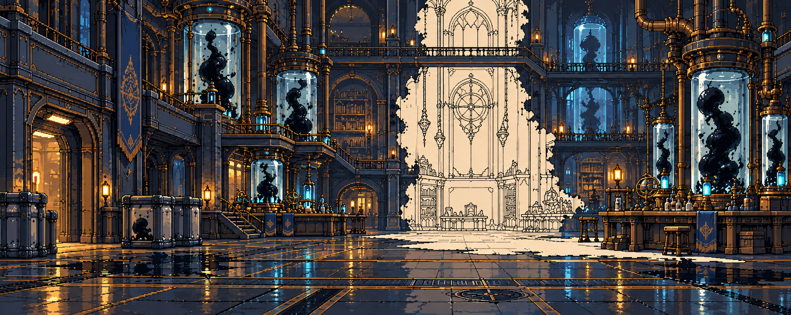

2026-10-22 검토용 이미지. v2의 정면 구도와 뒤쪽 흰 벽·바닥의 짙은 스케치 윤곽을 유지하고, 건축·설비·바닥의 선과 명암을 더 뚜렷한 픽셀 클러스터로 정리했습니다. 실제 게임 해상도나 타일 크기에 맞춘 최종 에셋은 아니며 Unity에는 적용하지 않았습니다.

## 비공개 잉크 연구동 배경 파노라마 v2

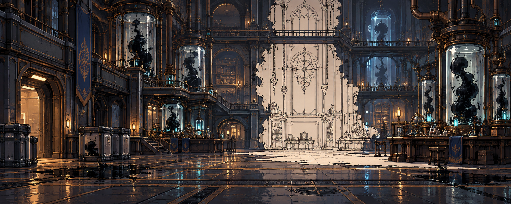

2026-10-22 검토용 배경 이미지. 사용자 피드백에 따라 부감 맵 대신 기존 연구동 배경처럼 사람 눈높이에서 실내의 깊이와 넓이를 바라보는 구도로 다시 만들었습니다. 중앙 벽과 연결된 바닥만 종이색·짙은 외곽선으로 스케치화되고, 주변 수거 용기와 분석 설비에는 어두운 색이 남습니다. 건축 양식과 설비 구성은 확정 설정이 아니며, 실제 게임 배경 레이어나 Unity 씬에는 반영되지 않았습니다.

## 비공개 잉크 연구동 부감 시안 v1

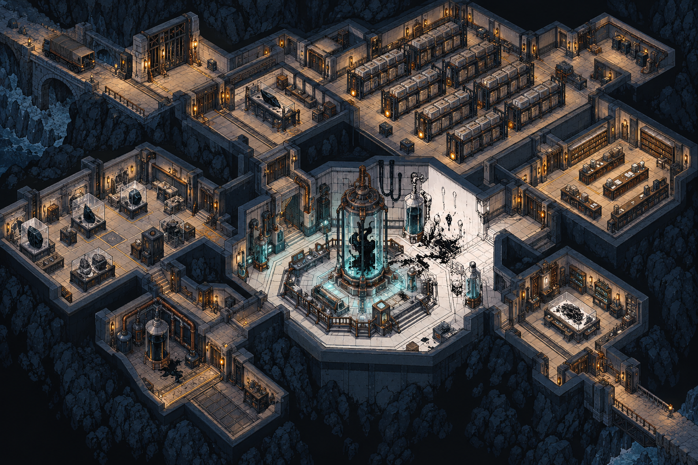

2026-10-22 검토용 이미지. 스토리북의 수거차 이송 경로, 다른 재난 지역 물품에 붙은 같은 형식의 표식, 비공개 수거·연구 시설이라는 단서를 바탕으로 진입 도크·보관 구역·기록실·중앙 분석실이 한눈에 보이는 부감 구도를 제안했습니다. 중앙 일부 벽과 바닥에만 스케치화 흔적을 두었습니다. 시설의 정확한 구조, 연구 장비, 지형과 동선은 확정 설정이 아닙니다. 이미지에 생성된 세부 표식은 읽을 수 있는 정식 번호가 아니며, 스토리의 `1845` 표기를 구현한 에셋이 아닙니다. 단일 합성 이미지로 실제 게임 맵·타일셋·Unity 씬에는 반영되지 않았습니다.

## 판타지 도시 횡스크롤 시안 v1

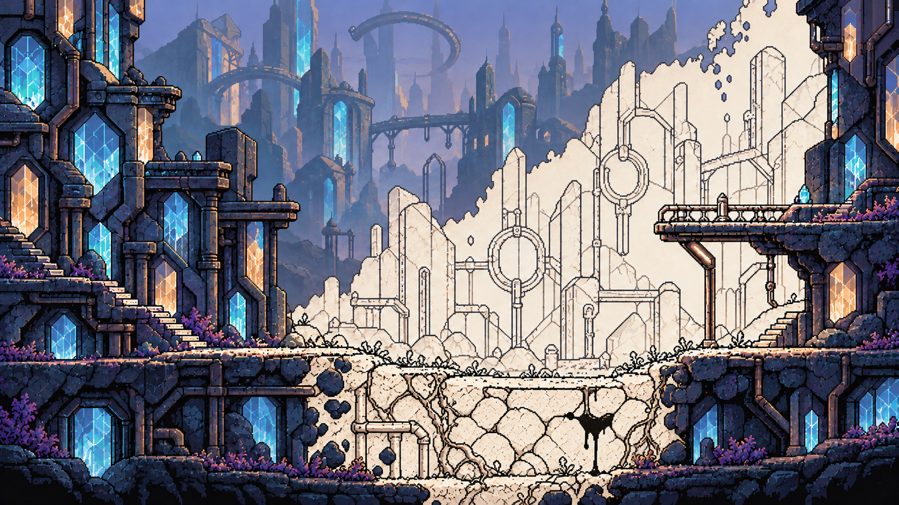

2026-10-22 검토용 이미지. 동아시아풍 등불과 지붕 대신 결정·유리 구조물이 있는 판타지 도시를 옆에서 바라본 횡스크롤 구도로 구성했습니다. 중앙 재난 구역은 건물뿐 아니라 보행 지면과 아래쪽 지층까지 종이색과 짙은 픽셀 윤곽으로 스케치화됩니다. 좌우로 이어지는 길과 일부 높이 차이는 구도 제안이며, 정확한 발판·충돌 지형은 맵 편집기에서 결정해야 합니다. 도시 건축과 시설은 확정 설정이 아닙니다. 단일 합성 이미지로, 편집기 JSON과 Unity 씬은 변경하지 않았습니다.

## 일정 영역의 스케치화 · 비교 시안

### 재난 경계 중심 v2

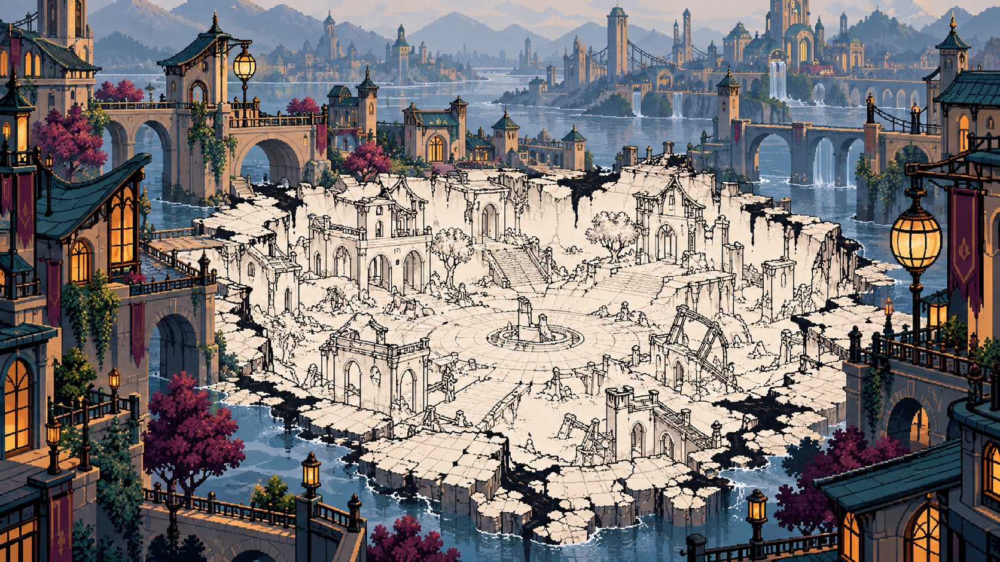

2026-10-22 검토용 이미지. 도시 전체가 옅어지는 대신 중앙 구역만 싱크홀처럼 내려앉고, 그 안의 건물·광장에 색과 부피가 빠진 표현입니다. 안쪽의 진한 창틀·벽돌·지붕 윤곽과 외곽의 정상 도시를 대비했습니다. 실제 지형 함몰 여부와 도시 건축은 확정 설정이 아닙니다.

### 판타지 도시 변형 v1

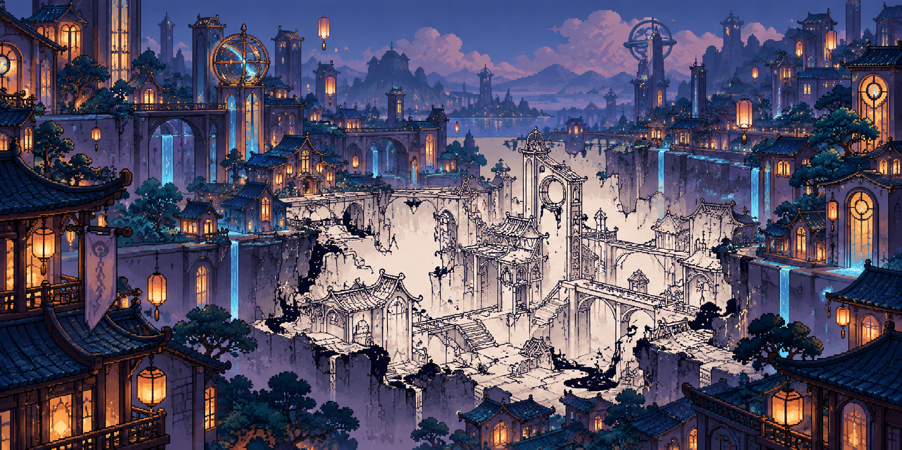

같은 국소 재난을 곡선 지붕·유리 구조물·발광 수로가 있는 도시로 바꾼 비교 시안입니다. 이 요소들은 분위기 탐색용이며 세계관에 새로 확정된 시설이나 지명이 아닙니다. 두 이미지는 단일 합성 배경 콘셉트이며 레이어·타일·카메라 규격, 게임용 픽셀 밀도는 검증 전입니다. Chapter1 숲 맵 편집기 JSON과 Unity 씬은 변경하지 않았습니다.

## 스케치화된 도시 배경 파노라마 v1

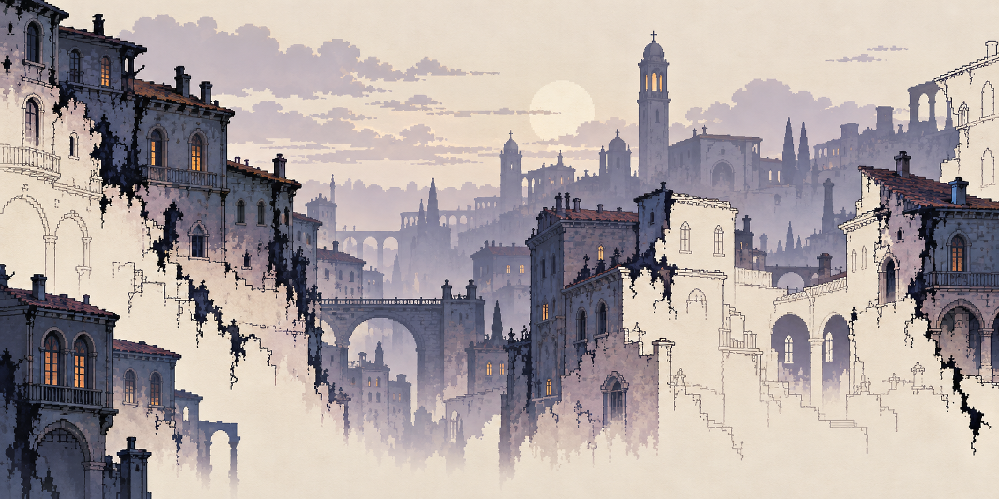

2026-10-21 검토용 배경 이미지. 이전 거리 시안의 캐릭터·몬스터·보행 지면·발판을 모두 제외하고, 첫 재난 지역으로 상상한 도시의 원경·중경만 새로 구성했습니다. 일부 건물은 어두운 색과 부피가 남고, 다른 부분은 종이색으로 비어 외곽선만 살아 있는 변화에 집중했습니다. 구체 도시 건축은 아직 확정 설정이 아닙니다. 단일 합성 이미지이므로 실제 적용에는 원경·중경 레이어 분리, 반복 경계, 카메라 이동, 기존 픽셀 밀도 검증이 필요합니다. Chapter1 맵 편집기의 지형·배치 JSON과 Unity 씬은 변경하지 않았습니다.

## 스케치화된 거리 v2 · 지면까지 이어지는 재난

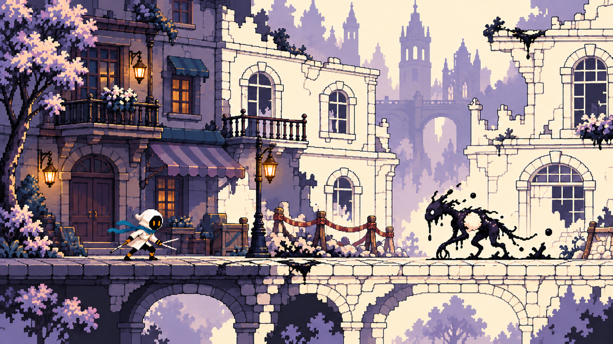

2026-10-21 사용자 피드백: v1은 건물만 희게 변하고 땅에는 재난이 적용되지 않았으며, 여러 가장자리에서 균일하게 흘러내린 잉크가 어색했습니다. v2는 **보행 지면과 아래쪽 돌 단면**까지 종이색·도트 외곽선으로 변하게 하고, 잉크는 중심부 균열·일부 파손부·잔형에만 남겼습니다. 완성 맵·확정 타일셋이 아닌 이미지 시안입니다.

공유받은 Chapter1 Map Ver2 편집기는 숲 지형·배치 구조를 JSON으로 조정하는 도구입니다. 이번 도시는 튜토리얼 장소의 별도 시각 제안이며 편집기 JSON, 기존 Chapter1 숲 맵, Unity 씬을 변경하지 않았습니다.

## 첫 전투 장소 제안 · 스케치화된 거리 v1

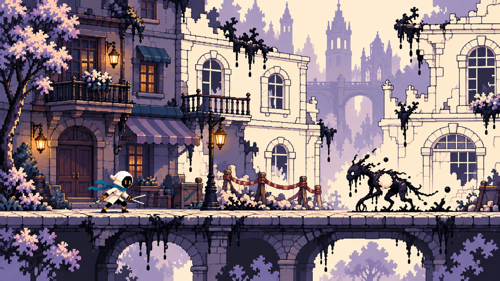

2026-10-21 검토용 이미지 시안. [스토리북](https://github.com/l-egulation/deviant-work/blob/work/story-design/story/storybook.html)의 도입 방향은 `색이 빠지는 거리 → 깜장이의 구조 → 아직 처리되지 않은 잔형과 첫 전투 → 현장 탈출`입니다. 도시 건물의 종류와 정확한 맵 구조는 정해져 있지 않아, 이 그림은 봉쇄된 거리 한 구간을 **시각 제안**으로 구성했습니다.

왼쪽 건물은 색과 부피가 남아 있고, 중앙과 오른쪽은 일부 면이 종이색으로 빠지면서 창틀·벽돌·아치의 도트 외곽선이 남습니다. 끊긴 곳의 잉크 방울과 몸속이 비어 보이는 잔형은 형태 표현 시험입니다. 거리 배치, 몬스터 외형, 무기와 캐릭터 포즈는 확정 설정이 아닙니다. 이 이미지는 실제 타일셋이나 Unity 적용본이 아니며, 제작 시 지형 충돌·카메라·픽셀 밀도와 전투 가독성을 별도 검증해야 합니다.

## 이전 숲 스타일 탐색

## v6 · 밝은 숲과 속이 비어 있는 잉크 형체

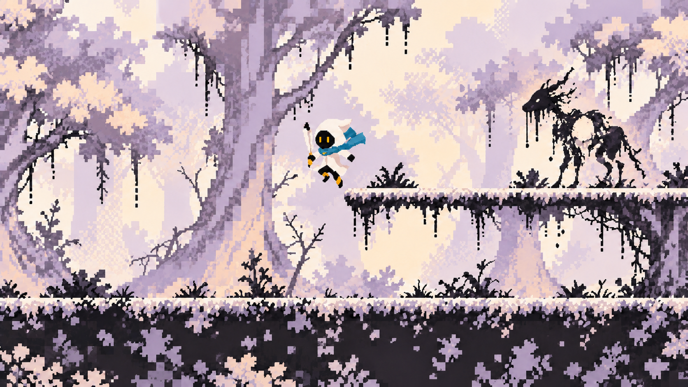

사용자 피드백(2026-10-21): v5는 원래 숲과 크게 다르지 않았습니다. 처음의 고대비 숲 구도를 바탕으로 색을 낮추고 흰색에 가까운 밝은 명암에 옅은 라벤더·살구색을 넣었습니다. 우측 형체는 몸 전체가 꽉 찬 생물이 아니라 빈틈과 떨어지는 먹방울이 보이도록 만든 **임시 스타일 예시**입니다. 몬스터 종·외형 확정이나 게임 적용을 뜻하지 않습니다. 지형·캐릭터와의 가독성은 실제 해상도에서 추가 검토가 필요합니다.

## v5 · 채색 실루엣과 잉크의 균형

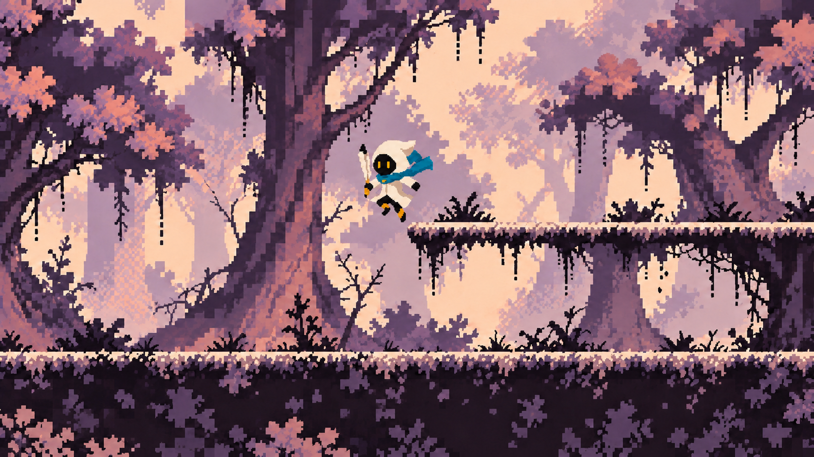

사용자 피드백(2026-10-21): v1의 숲 형태와 먹 분위기는 좋지만 흑백에 가까웠고, v4는 색이 너무 빠져 배경 형태를 구분하기 어려웠습니다. v5는 먼 숲과 나무의 색 면을 다시 채워 형태를 읽히게 하고 보랏빛·살구빛을 절제해서 넣었습니다. 일부 가지 끝과 먼 수풀에만 종이 여백과 흐려지는 흔적을 남겼습니다. 검토용 이미지 시안이며 실제 타일셋·Unity 적용본은 아닙니다.

## v4 · 한 나무 안에서 색과 윤곽이 함께 지워지는 숲

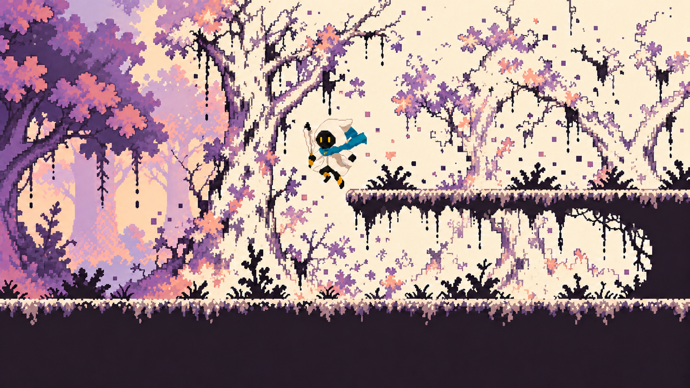

v3 검토 후 수정(2026-10-21): 온전한 색칠 전 도안처럼 보이던 윤곽을 일부 끊고, 한 나무 안에서도 잔색·빈 종이·먹 자국이 섞이도록 했습니다. 지면과 발판의 충돌 실루엣은 이어 두었습니다. 떠 있는 픽셀 조각의 밀도는 후속 검토 대상입니다. 검토용 이미지 시안이며 실제 타일셋·Unity 적용본은 아닙니다.

## v3 · 외곽선에 소량의 검은 명암

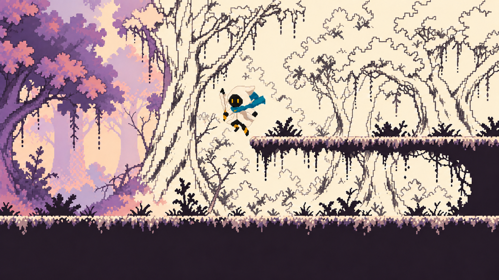

사용자 피드백(2026-10-21): v2의 색이 지워진 외곽선 표현을 유지하고 나무 홈·가지 아래 등에 검은 명암을 조금만 더합니다. v1처럼 넓은 면을 명암으로 채우지 않습니다. 검토용 이미지 시안입니다.

## v2 · 색이 지워지고 외곽만 남는 숲

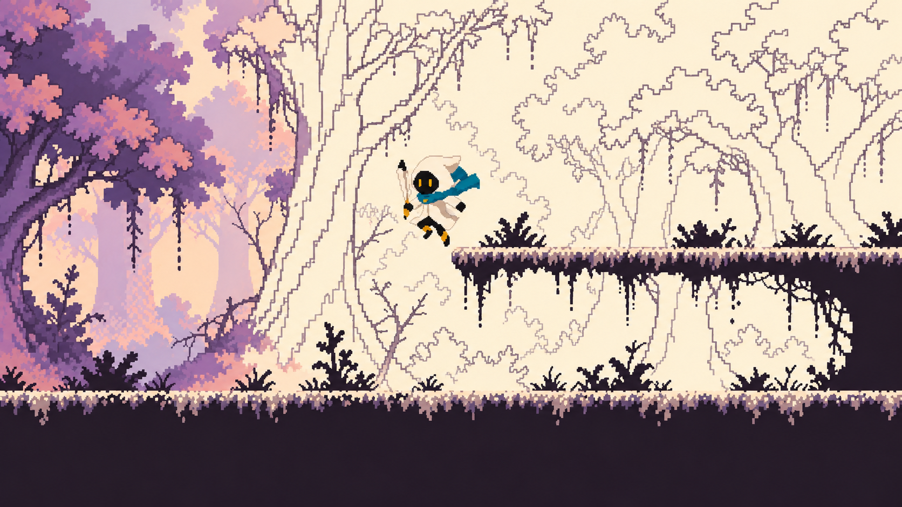

사용자 피드백(2026-10-21): 원하는 스케치 느낌은 여러 선으로 음영을 칠한 그림이 아니라, **색이 빠지고 외곽선만 남은 모습**. 왼쪽의 기존 숲 색이 오른쪽으로 갈수록 사라지고 도트 외곽과 종이색 내부만 남도록 시험했습니다. 캐릭터와 발판은 읽히도록 채색·실루엣을 유지합니다. 검토용 이미지 시안이며 타일셋이나 Unity 적용본은 아닙니다.

## v1 · 명암 중심 초기 시안

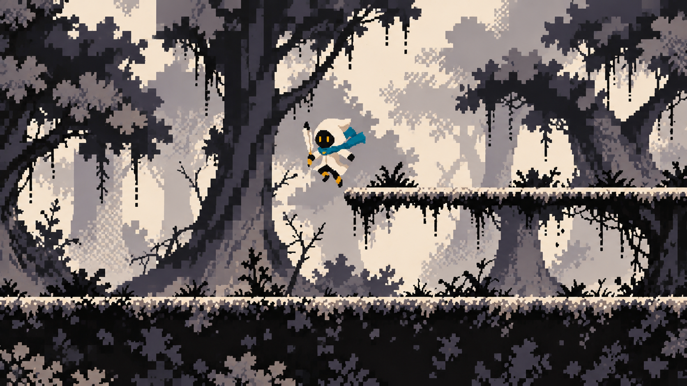

- 상태: **검토용 이미지 시안**. 승인 에셋, 타일셋, Unity 적용본이 아닙니다.
- 제작일: 2026-10-21.
- 방향: 기존 횡스크롤 숲 화면의 지면·발판 구도와 잉크 주인공의 가독성을 참고하고, 사용자가 제공한 흑백 스케치 이미지의 종이 여백·먹 번짐·지워진 기록 분위기를 도트 표현으로 옮겼습니다. 도시와 거대 몬스터 등 참고 이미지의 소재는 가져오지 않았습니다.
- 검토 포인트: 밝은 종이 배경과 검정 실루엣의 대비, 청록 스카프가 유일한 강한 색으로 읽히는지, 어두운 지형 아래쪽의 시각 밀도가 적절한지.
- 제작 단계에서 필요한 작업: 배경·전경·충돌 지형 분리, 실제 게임 해상도와 픽셀 밀도 맞춤, 반복 타일과 패럴랙스 제작, 캐릭터·HUD 합성 화면 검증.
