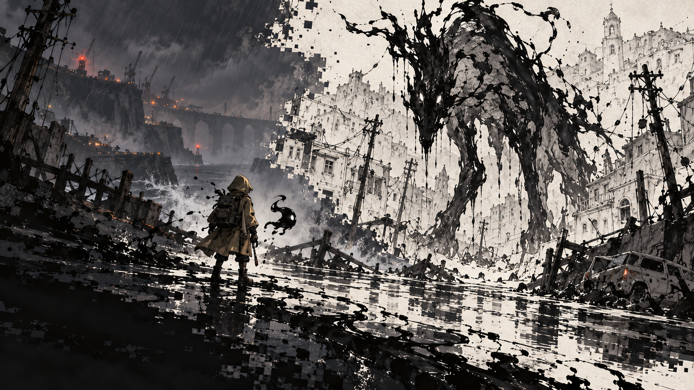

# 『Deviant』 스토리 작업

**팀 공유 파일:** [스토리 콘셉트북 HTML](storybook.html). GitHub 파일 화면에서 **Download raw file**로 저장하세요. 표지 이미지와 디자인이 HTML 안에 포함되어 있으므로 `storybook.html` 파일 하나만 전달하면 됩니다. 내려받은 파일을 브라우저에서 열어 보세요. `assets/`의 이미지는 후속 편집을 위한 원본이며 함께 전달할 필요는 없습니다.

## 현재 이야기의 뼈대

1. 스케치화는 오래전부터 생물과 무생물을 휩쓸어 잉크를 남기는 재난이다. 가공 잉크는 일상 기술에 쓰인다. 재난 뒤에는 움직이며 사람을 공격하는 잉크 잔여물, 가칭 ‘잔형’이 남는다. 위험 구역은 봉쇄되고 공개 대응팀이 잔형을 처리한다. 일반인은 재난 뒤 위험이 있다는 정도만 알 뿐 괴물의 모습과 원액 처리 과정은 거의 보지 못한다.
2. 지역 재난 예보·조사 직원인 주인공이 이상 징후를 확인하러 갔다가 현장에서 죽는다. 정체가 아직 밝혀지지 않은 잉크 동행자 ‘깜장이’가 주인공을 다시 움직이게 한다. 주인공도 위험 잔여물에 대한 규정은 알지만 실제 괴물은 처음 본다. 아직 대응팀이 정리하지 못한 잔형이 탈출로를 막아 두 사람은 곧바로 싸워야 한다.
3. 탈출 직전, 주인공은 평소 수거대와 다른 인원들이 잉크를 회수하는 모습을 숨은 채 본다. 무전에서 “1845, 회수 완료”라는 말이 들리고, 수거 용기에도 같은 번호가 있다. 그 안에는 주인공이 현장에서 본 누군가의 물건이 들어 있다. 번호의 뜻과 인원들의 소속은 아직 모른다.
4. 주인공은 사고 신고와 지원을 요청하려고 직속 상사를 찾는다. 죽은 줄 알았던 직원의 생환에 놀란 상사는 ‘1845’를 듣고 잠깐 말을 멈춘다. 잉크로 변한 몸까지 본 뒤 비상 보고 절차를 밟고, 주인공의 현장 접근과 보고가 막힌다. 신원을 확인하려는 인원들이 주인공을 찾기 시작한다. 상사의 가담 범위는 미정이다.
5. 공식 조사가 막힌 주인공은 자신이 목격한 수거차의 이송 경로를 따라 첫 수거 시설로 향한다. 그곳에서 같은 형식의 표식이 다른 재난 지역의 물품에도 붙어 있음을 보고 조사 범위를 넓힌다. 이 경로 연결은 검토 중인 전개안이다.
6. 여러 재난 지역을 거치며 지역마다 다른 생존 방식과 비극을 본다. 일부 정부 조직은 생명이 남긴 특별한 잉크를 독점하고, 인위적으로 재난을 일으킨 사건까지 은폐해 왔다.
7. 깜장이의 정체, 잔형의 정확한 원리, ‘1845’와 MSD 같은 약어의 뜻, 부활·재도전의 원리, 최종 반전과 엔딩은 아직 결정하지 않았다.

## 지역·보스 설계 예시

**제물을 바치던 마을 → 겹쳐진 사람들.** 마을의 문마다 검은 손도장이 찍혀 있고, 제단에는 여러 이름이 포개져 있다. 깊은 곳의 보스는 희생된 사람들의 잉크 잔여물이 뒤섞인 모습이다. 처음에는 공간과 적의 모습으로 불길함을 느끼고, 클리어 뒤 선택해서 읽는 장부와 대화로 풍습의 수혜자를 알게 된다. 확정 스테이지가 아닌 방향 예시다.

지역을 설계할 때는 **생존 방식 → 공간의 흔적 → 일반 적의 행동 → 보스의 정체**가 하나의 사연으로 연결되게 한다. 자세한 설명을 읽지 않아도 전투와 맵만으로 분위기가 전해져야 한다.

## 전투 중 읽는 기록

첫 현장에는 작업표와 수거 용기의 ‘1845’ 표식처럼 짧은 단서만 둔다. 수거 시설에서는 다른 회수 건의 분류 기록을 발견한다.

> 회수 대상 중 생체 반응 1건. 일반 잉크로 분류하지 말 것.

이 문구가 누구를 가리키는지는 미정이다. 이후 시설에서는 외부 접촉, 기록 정정, 인원 이동을 암시하는 조각을 발견한다. 현장과 보스의 모습으로 핵심 분위기를 먼저 전달하고, 문서는 원하는 플레이어가 더 깊이 읽는 방식이다. 첫 현장의 비밀 인원들이 주인공을 이미 발견했다는 뜻으로 이 기록을 쓰지 않는다.

## 배경 디자인 시안

아래 세 장은 첫 재난 현장 → 상사의 지역 조사 사무실 → 비공개 잉크 연구동으로 이어지는 장소 시안이다. 첨부받은 흑백 잉크 재난 이미지의 분위기를 참고하고 도트 질감을 약하게 더했다. 게임용 레이어·타일·최종 구조는 아직 제작하지 않았다.

1. [첫 스케치화 재난 지역](assets/background-concepts/01-sketch-disaster-zone.png): 공개 대응팀이 아직 정리하지 못한 잔형과 싸우는 현장.
2. [상사가 있는 지역 조사 사무실](assets/background-concepts/02-regional-investigation-office.png): 생환을 보고하고 ‘1845’를 언급하는 장소. 전투 구역이 아닌 짧은 대면 장면용.
3. [비공개 잉크 연구동](assets/background-concepts/03-concealed-ink-research-wing.png): 수거차의 이송 경로를 따라 도착하는 다음 전투 지역의 시안.

## 문서 상태

`storybook.html`의 녹색 표시는 현재 방향, 갈색은 전개 제안·설계 가설, 붉은색은 미정이다. 표지 이미지는 사용자가 제공한 흑백 잉크 재난 이미지의 분위기를 참고해 새로 만든 도트 질감 콘셉트 아트이며 게임의 최종 디자인이 아니다. 기존 세계관 원문이나 과거 시안을 변경하지 않고, 이번 스토리 논의의 새 작업본을 별도로 보관한다.
