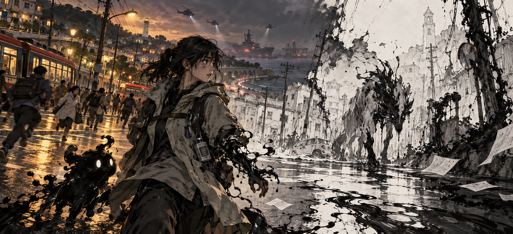

# 『잃어버린 말』 스토리 작업

[스토리 콘셉트북 HTML 보기](storybook.html) · HTML 파일을 내려받아 브라우저에서 열면 책 형태의 레이아웃으로 볼 수 있습니다. 그림은 HTML과 같은 폴더에 두어야 표시됩니다.

## 현재 이야기의 뼈대

1. 스케치화는 오래전부터 생물과 무생물을 휩쓸어 잉크를 남기는 재난이다. 가공 잉크는 일상 기술에 쓰이고, 원액을 자유롭게 다루는 사람은 드물다.
2. 지역 재난 예보·조사 직원인 주인공이 현장에서 죽는다. 정체가 아직 밝혀지지 않은 잉크 동행자 ‘깜장이’가 주인공을 다시 움직이게 한다. 두 사람은 현장에서 곧바로 싸우며 탈출한다.
3. 탈출 직전, 주인공은 평소 수거대와 다른 인원들이 잉크를 회수하는 모습을 숨은 채 본다. 무전에서 “1845, 회수 완료”라는 말이 들리고, 수거 용기에도 같은 번호가 있다. 그 안에는 주인공이 현장에서 본 누군가의 물건이 들어 있다. 번호의 뜻과 인원들의 소속은 아직 모른다.
4. 주인공은 사고 신고와 지원을 요청하려고 직속 상사를 찾는다. 죽은 줄 알았던 직원의 생환에 놀란 상사는 ‘1845’를 듣고 잠깐 말을 멈춘다. 이후 주인공의 현장 접근과 보고가 막히기 시작한다. 상사의 가담 범위와 직접적인 차단 경위는 미정이다.
5. 여러 재난 지역을 거치며 지역마다 다른 생존 방식과 비극을 본다. 일부 정부 조직은 생명이 남긴 특별한 잉크를 독점하고, 인위적으로 재난을 일으킨 사건까지 은폐해 왔다.
6. 깜장이의 정체, ‘1845’와 MSD 같은 약어의 정확한 뜻, 부활·재도전의 원리, 최종 반전과 엔딩은 아직 결정하지 않았다.

## 지역·보스 설계 예시

**제물을 바치던 마을 → 겹쳐진 사람들.** 마을의 문마다 검은 손도장이 찍혀 있고, 제단에는 여러 이름이 포개져 있다. 깊은 곳의 보스는 희생된 사람들의 잉크 잔여물이 뒤섞인 모습이다. 처음에는 공간과 적의 모습으로 불길함을 느끼고, 클리어 뒤 선택해서 읽는 장부와 대화로 풍습의 수혜자를 알게 된다. 확정 스테이지가 아닌 방향 예시다.

지역을 설계할 때는 **생존 방식 → 공간의 흔적 → 일반 적의 행동 → 보스의 정체**가 하나의 사연으로 연결되게 한다. 자세한 설명을 읽지 않아도 전투와 맵만으로 분위기가 전해져야 한다.

## 문서 상태

`storybook.html`의 녹색 표시는 현재 방향, 갈색은 전개 제안·설계 가설, 붉은색은 미정이다. 표지 이미지는 분위기용 생성 콘셉트 아트이며 게임의 최종 디자인이 아니다. 기존 세계관 원문이나 과거 시안을 변경하지 않고, 이번 스토리 논의의 새 작업본을 별도로 보관한다.
